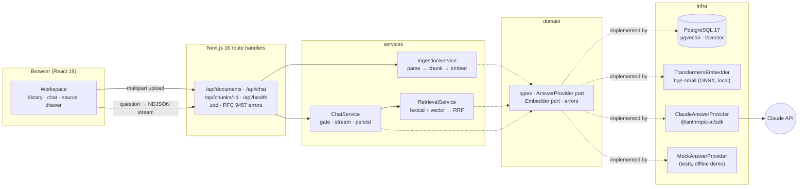
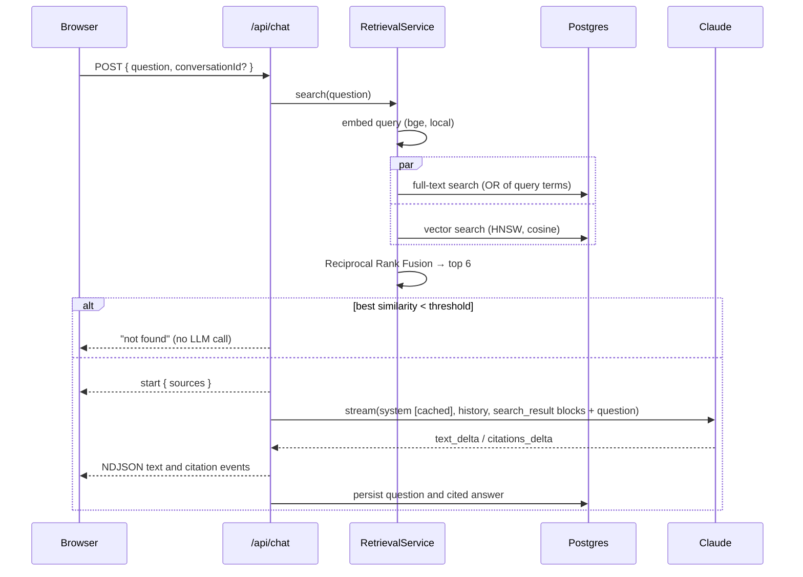

# DocuMind


Chat with your documents and get answers with citations. You upload PDFs, Markdown or text files. DocuMind splits them into passages, indexes them in PostgreSQL for full-text and vector search, and streams answers from Claude. Every claim in an answer carries a numbered citation that opens the exact source passage, with the cited sentence highlighted. When the documents don't contain the answer, DocuMind says so instead of guessing.

This is a portfolio project. It is built to show how I structure a full-stack AI feature end to end: a Next.js UI, a layered backend, a measurable retrieval pipeline and an LLM integration done by the book.

## Highlights

- **Hybrid retrieval in plain Postgres**: `tsvector` full-text search (`ts_rank_cd`, headings weighted above body text) and pgvector cosine similarity (HNSW index), fused with **Reciprocal Rank Fusion**. No separate vector database.
- **Citations come from the API, not from regex**: retrieved chunks go to Claude as `search_result` content blocks with `citations: { enabled: true }`. The streamed `citations_delta` events are mapped back to the stored chunk by index and source URI.
- **Grounded or silent**: a cheap similarity gate skips the LLM call entirely for clearly out-of-scope questions. The system prompt makes Claude answer only from the passages and reply with a fixed "not found" sentence otherwise.
- **Claude done properly**: `claude-opus-5-5` with adaptive thinking, explicit `output_config.effort`, streaming, prompt caching on a stable system prompt, `stop_reason` handling (including `refusal`), typed SDK errors mapped to readable messages, and abort propagation when the user presses Stop.
- **Local embeddings**: `Xenova/bge-small-en-v1.5` runs in-process through `@huggingface/transformers` (ONNX, quantised), so the only API key you need is Anthropic's, and only for live answers.
- **Measured, not assumed**: an eval set of 20 questions over a seed corpus reports hit@k and MRR for lexical, vector and hybrid retrieval, plus answer correctness and citation validity with Claude.
- **Tested at three levels**: 65 unit tests, 12 integration tests against real Postgres + pgvector, and a Playwright end-to-end test (upload → ask → open the cited passage) that runs with a deterministic mock LLM.

## Architecture



Route handlers only validate input and translate errors. Services hold the logic and depend on small interfaces (`Pick<Repository, ...>`, `Embedder`, `AnswerProvider`). Concrete classes are created only in [`src/container.ts`](src/container.ts), which is how the e2e test swaps Claude for the mock with one environment variable.

### What happens when you ask a question



Uploads answer `202` right away. Parsing, chunking and embedding continue after the response through Next's `after()`. The library polls while a document shows "Indexing...". Chunks are written and the document flipped to `ready` in a single transaction, so search never sees a half-indexed file.

## Retrieval design decisions

**Chunking follows the document's structure.** Markdown is cut at headings first, so a chunk never mixes two sections, and every chunk remembers its heading path (`Handbook › Leave › Vacation`). Inside a section, whole paragraphs are packed up to about 1,000 characters. Oversized paragraphs fall back to sentence boundaries (`Intl.Segmenter`), then word boundaries. Consecutive chunks share a sentence-aligned overlap of up to 200 characters, so a fact that straddles a boundary is still retrievable. Each chunk is embedded together with its document title and heading, which helps with short sections like FAQ answers.

**Two retrievers, fused by rank.** Keyword search is precise for names, numbers and exact terms ("WPA2-Enterprise", "1,200 EUR"). Embeddings handle paraphrases ("carrying the pager" → "on-call rotation"). Their scores live on different scales (`ts_rank_cd` is unbounded, cosine similarity is in [-1, 1]), so instead of normalising and weighting them, RRF combines only ranks: `score = Σ 1/(60 + rank)`. It has no parameters to tune and is robust to one retriever returning junk. `plainto_tsquery` produces AND queries, which are too strict for natural-language questions, so the repository rewrites them to OR and lets `ts_rank_cd` reward passages that match more terms close together.

**A deliberately permissive "no answer" gate.** If the best cosine similarity is below `RETRIEVAL_MIN_SIMILARITY` (0.5), the question is answered with "not found" without calling Claude. A false "not found" on an answerable question is worse than an unnecessary LLM call, so the threshold sits below every answerable question in the eval set. The gate is a cost filter, not the safety net: questions that are on-topic but unanswerable ("What was the company's revenue?") pass it, and Claude's instructions handle them.

**`search_result` blocks instead of `document` blocks.** Both support citations. Search result blocks are designed for RAG: each carries a `source` URI (`documind://chunks/<uuid>`) and a title, and citations come back as `search_result_location` with the index of the result. Each paragraph is a separate text block, which keeps cited spans tight. The mapping prefers the index and falls back to the URI, so a citation can never be attributed to the wrong passage.

**Prompt caching.** The system prompt contains no dates, IDs or per-request data and is kept above Opus 5.5's 512-token minimum cacheable prefix, with a `cache_control` breakpoint on it. Retrieved passages and the question go in the final user turn, after the cached prefix. Effort and thinking settings are fixed per deployment, because changing them invalidates the cache.

**Trade-offs and what I would add next.** No reranker: a cross-encoder would likely fix the hybrid hit@1 dip below, but it adds latency and another model, and the corpus is small. Answers are grounded in the current turn's passages only, so a follow-up question is retrieved on its own text, not rewritten with the conversation history first. Query rewriting would be the next step. Ingestion runs in the web process through `after()`. That is fine for a demo, but a real deployment would move it to a job queue.

## Evaluation

The seed corpus in [`evals/corpus`](evals/corpus) is four short, self-written documents about a fictional company: an employee handbook, a product FAQ, a security policy (plain text) and an engineering onboarding guide. [`evals/cases.json`](evals/cases.json) has 20 questions. 17 are answerable, and 4 of those are paraphrased so that they share few keywords with the source. 3 are out of scope. Each answerable case names an `evidence` phrase that occurs only in the passage that answers it.

```bash
npm run eval:retrieval   # no API key needed
npm run eval:answers     # needs ANTHROPIC_API_KEY
```

The evals run in a separate `<db>_eval` database, so your own uploads never skew the numbers.

**Retrieval** (17 answerable questions, rank of the first chunk that contains the evidence):

| Strategy     | hit@1 | hit@3 | hit@6 |   MRR |
| ------------ | ----: | ----: | ----: | ----: |
| Lexical only |   88% |   88% |   94% | 0.900 |
| Vector only  |   94% |  100% |  100% | 0.961 |
| Hybrid (RRF) |   82% |  100% |  100% | 0.912 |

**No-answer gate**: 19 of 20 questions classified correctly. The miss is the on-topic but unanswerable revenue question, which passes the gate by design and is left to Claude.

How to read this honestly: the corpus is tiny, so these numbers show that the pipeline works, not how it performs at scale. On this set, vector search alone ranks slightly better at position 1. RRF pulls a few lexically noisy chunks up to rank 1 and pushes the right one to rank 2. Hybrid still matters for what matters downstream: the right passage is in the top 3 for every question, which is all Claude needs, since it sees the top 6. On larger corpora full of exact identifiers (error codes, SKUs, names), the lexical side is what keeps recall up.

**Answers with Claude** (`claude-opus-5-5`, effort `low`): not run yet. The eval needs an API key, and none was available when this was built. The script checks that each answer contains the expected facts, that every citation's cited text really occurs in the chunk it was mapped to, that at least one citation points at the evidence passage, and that out-of-scope questions get exactly the "not found" sentence. It writes per-question results to `evals/results/answers.json`.

## Quick start

Requirements: Node.js 22.12+ and PostgreSQL 16+ with the pgvector extension.

```bash
# 1. Database: either Homebrew...
brew install postgresql@17 pgvector && brew services start postgresql@17
createdb documind
# ...or Docker
docker compose up -d    # then set DATABASE_URL from .env.example

# 2. App
npm install
cp .env.example .env    # set ANTHROPIC_API_KEY, or LLM_PROVIDER=mock to try it without one
npm run seed            # migrate + ingest the sample corpus (downloads the ~35 MB embedding model once)
npm run dev             # http://localhost:3000
```

Without an API key, everything except live answers works: upload, ingestion, retrieval, the "not found" gate and the evals. `LLM_PROVIDER=mock` gives a deterministic cited answer (it quotes the best passage), which is how the e2e test runs.

Try "How many vacation days do full-time employees get?", "Can Beacon connect to a 5 GHz network?" or "What will the weather be like tomorrow?".

## API

| Method | Path                 | Description                                                                    |
| ------ | -------------------- | ------------------------------------------------------------------------------ |
| GET    | `/api/documents`     | Library with status (`processing` / `ready` / `failed`) and chunk counts       |
| POST   | `/api/documents`     | Multipart upload (`file`, repeatable). `202` and ingestion continues afterward |
| DELETE | `/api/documents/:id` | Delete a document and its chunks                                               |
| POST   | `/api/chat`          | `{ question, conversationId? }` → NDJSON stream of `ChatEvent`s                |
| GET    | `/api/chunks/:id`    | Full passage behind a citation                                                 |
| GET    | `/api/health`        | Database check and answer mode (`claude` / `mock` / `unconfigured`)            |

The chat stream is one JSON object per line: `start` (conversation ID and numbered sources), then `text` and `citation` events addressed to answer segments, then `end` with the stop reason (`end_turn`, `max_tokens`, `refusal` or `no_context`). The same reducer ([`src/domain/answer.ts`](src/domain/answer.ts)) folds these events on the server, to persist the answer, and in the browser, to render it, so both always agree. Errors are RFC 9457 problem details with per-field validation messages.

## Configuration

All settings are environment variables, validated with zod. See [`.env.example`](.env.example).

| Variable                   | Default                              | Description                                                                         |
| -------------------------- | ------------------------------------ | ----------------------------------------------------------------------------------- |
| `DATABASE_URL`             | `postgres://localhost:5432/documind` | PostgreSQL with pgvector                                                            |
| `LLM_PROVIDER`             | `anthropic`                          | `anthropic` or `mock`                                                               |
| `ANTHROPIC_API_KEY`        | (none)                               | Also read from `ANTHROPIC_ENV_FILE` (default `../.anthropic.env`), outside the repo |
| `CLAUDE_MODEL`             | `claude-opus-5-5`                    | Any Messages API model ID                                                           |
| `CLAUDE_EFFORT`            | `low`                                | `low` … `max`; Opus 5.5 always thinks, effort bounds how much                       |
| `EMBEDDING_MODEL`          | `Xenova/bge-small-en-v1.5`           | 384 dimensions, matching the schema                                                 |
| `RETRIEVAL_TOP_K`          | `6`                                  | Passages sent to Claude                                                             |
| `RETRIEVAL_MIN_SIMILARITY` | `0.5`                                | "Not found" gate on the best cosine similarity                                      |
| `MAX_UPLOAD_MB`            | `10`                                 | Per-file upload limit                                                               |

## Testing

```bash
npm run lint && npm run typecheck && npm run format:check
npm test                    # unit tests, no database needed
npm run test:integration    # real Postgres + pgvector, in a separate documind_test database
npm run test:e2e            # Playwright, mock LLM, separate documind_e2e database
```

- **Unit tests** cover the chunker (heading paths, fenced code, packing, overlap, oversized paragraphs), RRF, the Claude adapter with a fake SDK client (request shape, cache stability, search-result blocks, citation mapping, streamed events, refusal, typed error mapping, abort), the chat service (weak-retrieval short-circuit, persistence, refusal, provider failure), retrieval, ingestion, PDF extraction (a PDF generated in the test), route validation and the streaming helpers.
- **Integration tests** ingest the seed corpus into real Postgres with the real embedding model and check stored vectors and `tsvector`s, ranking, paraphrase recall, stop-word queries, the gate, cascade deletes, the chat endpoint end to end with persisted conversations, and migration idempotency.
- **End-to-end**: upload a Markdown file in the browser, wait for indexing, ask a question, click citation 1 and see the highlighted passage, then check the "not found" state.

CI (GitHub Actions) runs everything above against a `pgvector/pgvector:pg17` service container, plus the retrieval eval and a production build.

## Project structure

```
src/
├── app/                  # Next.js: page, layout, route handlers under api/
├── components/           # workspace, document library, chat panel, answer, source drawer
├── hooks/                # useDocuments (upload, polling), useChat (NDJSON streaming)
├── domain/               # types, errors, answer-event reducer. No dependencies.
├── services/             # chunker, RRF, retrieval, ingestion, chat
├── infra/
│   ├── db/               # pg pool, migration runner, repositories
│   ├── llm/              # Claude adapter + deterministic mock
│   ├── embedder.ts       # transformers.js feature extraction
│   └── parsers.ts        # PDF / Markdown / text extraction
├── lib/                  # HTTP helpers, zod schemas, NDJSON, highlighting
├── config.ts             # validated environment
└── container.ts          # composition root
db/migrations/            # SQL migrations
scripts/                  # migrate, seed
evals/                    # corpus, cases, eval runner
tests/unit · tests/integration · e2e/
```

## License

[MIT](LICENSE) © 2026 Yusuf Yuldashev
